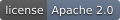

<div align="center">


# Airman Mode

**Opinionated agent workflows for the whole software lifecycle.**<br />
Plan it, build it, fix it, and prove it, with any coding agent that speaks Agent Skills.


<a href="LICENSE"></a>

[Getting started](#getting-started) · [Commands](#commands) · [Skills](#skills) · [Credits](#credits)

</div>

---

| Document | Read it when |
| --- | --- |
| [Concepts](docs/concepts.md) | You want the mental model: commands, skills, and the work folder |
| [Repo setup](docs/setup.md) | You want to know what `/setup-airman` asks and writes |
| [Commands](#commands) | You want what each command does, and the skills it runs in order |
| [Skills](#skills) | You want to run one skill, or see what a command uses |
| [Tool guides](docs/harness/README.md) | You use Claude Code, Codex, Cursor, T3 Code, Antigravity, or Kiro |
| [Writing skills](docs/authoring.md) | You're adding or changing a skill |
| [Design decisions](docs/design.md) | You wonder why it works this way, or what's next |
| [Credits](docs/credits.md) | You want to know what came from Matt Pocock and poteto |

## Getting started

You need Node.js (for `npx`), a git repository, and an agent that supports [Agent Skills](https://agentskills.io).

**1. Install** every skill globally, and pick your agents when asked:

```bash
npx skills add mrizkiaiman/airman-mode --skill '*' --global
```

Or name the agents up front:

```bash
npx skills add mrizkiaiman/airman-mode --skill '*' --global -a claude-code -a codex -a cursor
```

> [!TIP]
> Install all skills, not just the commands. Commands call other skills by name.

**2. Set up each repo** once. Open your agent in the project and run:

```text
/setup-airman
```

It reads the repo, asks where tickets live and how to test and run the app, then writes `docs/agents/` and a short block in `AGENTS.md`. See [Repo setup](docs/setup.md).

**3. Keep it current** with `npx skills update`. To remove one skill, run `npx skills remove <name> --global`.

## Commands

Type a command, then describe the task in plain words, for example `/fix-bug checkout fails with a discount code`. Commands run only when you type them.

| Command | What it does | Skills, in order |
| --- | --- | --- |
| [`/new-feature`](docs/commands/new-feature.md) | <ul><li>Builds a brand-new feature</li><li>Sizes it first: small or large</li><li>Small: builds it test-first, runs the repo's checks, gets a review</li><li>Large: interviews you, writes a spec, splits it into tickets, then stops</li></ul> | **Small:** `tdd` → `code-review`<br />**Large:** `grilling` + `domain-modeling` → `to-spec` → `to-tickets` |
| [`/fix-bug`](docs/commands/fix-bug.md) | <ul><li>Builds a check that fails on the bug before touching code</li><li>Finds the cause with evidence, not guesses</li><li>Commits the failing test, then the smallest fix</li><li>Proves it with the repo's checks and a fresh review</li></ul> | `diagnosing-bugs` → `tdd` → `code-review` |
| [`/new-app`](docs/commands/new-app.md) | <ul><li>Turns an idea into a map of open decisions</li><li>Settles one decision per session</li><li>Adds test, lint, and CI</li><li>Writes the spec and tickets for the first slice</li></ul> | `setup-airman` → `wayfinder` → `grilling` / `prototype` / `research` per decision → `to-spec` → `to-tickets` |
| [`/revamp-page`](docs/commands/revamp-page.md) | <ul><li>Redesigns an existing page without losing what it does</li><li>Records before screenshots and a behavior inventory, then locks it in tests</li><li>Picks a direction from three variants or your design</li><li>Small: builds, compares after screenshots, gets a review. Large: spec and tickets</li></ul> | `tdd` → `grilling` → `ui-ux-pro-max` + `prototype` → **Small:** `shadcn` → `code-review` + `ui-ux-pro-max`<br />**Large:** `to-spec` → `to-tickets` |

When a command writes tickets, build them with the `implement` skill: `/implement docs/work/<slug>`.

## Skills

Skills do one job each. Commands call them for you, and you can also run any of them on their own by name, for example `/tdd` or `/investigate`.

### Planning

| Skill | What it does | Used by |
| --- | --- | --- |
| `grilling` | <ul><li>Interviews you in rounds until you agree on a plan</li><li>Every question comes with a recommended answer</li><li>Looks up facts in the code and docs itself</li></ul> | `/new-feature`, `/new-app`, `/revamp-page` |
| `to-spec` | <ul><li>Turns the conversation into a spec, no new interview</li><li>Covers the problem, solution, user stories, and test seams</li><li>Saves it to the tracker, by default `docs/work/<slug>/spec.md`</li></ul> | `/new-feature`, `/new-app`, `/revamp-page` |
| `to-tickets` | <ul><li>Splits a spec into thin end-to-end tickets</li><li>Each ticket lists the tickets that block it</li><li>One file per ticket in `docs/work/<slug>/issues/`</li></ul> | `/new-feature`, `/new-app`, `/revamp-page` |
| `wayfinder` | <ul><li>Plans work too big for one session</li><li>Builds a map of decision tickets: research, prototype, interview, or task</li><li>Settles one ticket per session until the way is clear</li></ul> | `/new-app` |
| `domain-modeling` | <ul><li>Challenges vague or conflicting terms</li><li>Writes agreed terms to `GLOSSARY.md`</li><li>Records hard-to-reverse decisions as ADRs</li></ul> | `/new-feature`, `/new-app` |
| `prototype` | <ul><li>Builds throwaway code to answer one design question</li><li>A logic demo for a state model, or switchable UI variants</li><li>Keeps the decision, not the code</li></ul> | `/new-app`, `/revamp-page` |
| `research` | <ul><li>Reads primary sources: official docs, source code, specs</li><li>Runs in the background</li><li>Saves cited findings to a markdown file</li></ul> | `/new-app` |

### Building

| Skill | What it does | Used by |
| --- | --- | --- |
| `implement` | <ul><li>Builds tickets in dependency order</li><li>Per ticket: claim, build test-first, check criteria, close, commit</li><li>Ends with the full checks and a fresh-context review</li></ul> | Run it after `/new-feature`, `/new-app`, or `/revamp-page` |
| `tdd` | <ul><li>One failing test, then only the code to pass it</li><li>Tests only at seams agreed with you up front</li><li>Refactoring waits for the review</li></ul> | `/new-feature`, `/fix-bug`, `/revamp-page`, `implement` |
| `diagnosing-bugs` | <ul><li>Builds a feedback loop that goes red on the bug</li><li>Reproduces, minimises, and ranks hypotheses</li><li>Instruments, fixes with a regression test, then cleans up</li></ul> | `/fix-bug` |
| `investigate` | <ul><li>Answers read-only questions about the code</li><li>"How does X work?" or "why is Y built this way?"</li><li>Traces the code and its git history, and cites both</li></ul> | On its own |
| `code-review` | <ul><li>Reviews a diff in a fresh context</li><li>Checks it against the repo's coding standards</li><li>Checks it against the spec or ticket</li></ul> | `/new-feature`, `/fix-bug`, `/revamp-page`, `implement` |
| `codebase-design` | <ul><li>Shared vocabulary for designing modules</li><li>Depth, interfaces, seams, and adapters</li><li>Used when the shape of the code is in question</li></ul> | `tdd`, `improve-codebase-architecture` |
| `improve-codebase-architecture` | <ul><li>Finds shallow modules worth deepening</li><li>Shows them in an HTML report</li><li>Talks you through the one you pick</li></ul> | On its own |

### Sessions

| Skill | What it does | Used by |
| --- | --- | --- |
| `setup-airman` | <ul><li>Configures a repo once</li><li>Where specs, tickets, the glossary, and ADRs live</li><li>The commands to test, typecheck, lint, and run the app</li></ul> | Run it yourself. `/new-app` runs it when it's missing |
| `handoff` | <ul><li>Prints a copy-paste summary of the session in the chat</li><li>Goal, state, decisions, open questions, and next step</li><li>Paste it as the first message of the next session</li></ul> | On its own |
| `retro` | <ul><li>Reviews a finished session</li><li>Suggests fixes to the agent's environment, not the prompt</li><li>Prefers checks that enforce themselves over written rules</li></ul> | On its own |

### Extras

| Skill | What it does | Used by |
| --- | --- | --- |
| `grill-me` | <ul><li>Starts `grilling` on its own</li><li>For an interview without a command around it</li></ul> | On its own |
| `unslop` | <ul><li>Removes AI-sounding patterns from writing</li><li>Restores a human voice</li></ul> | On its own |
| `teach` | <ul><li>Teaches a topic across sessions</li><li>Keeps a mission, lessons, references, and progress records</li></ul> | On its own |
| `shadcn` | <ul><li>Adds, searches, and fixes shadcn/ui components</li><li>Styles and composes components and registries</li></ul> | `/revamp-page` |
| `ui-ux-pro-max` | <ul><li>Searchable design database: styles, palettes, font pairings, UX rules</li><li>Used to plan and review interfaces</li></ul> | `/revamp-page` |
| `no-use-effect` | <ul><li>Replaces direct `useEffect` in React</li><li>Uses derived state, event handlers, `useMemo`, or a data library instead</li></ul> | `/revamp-page` |

## Credits

Built on the work of **[Matt Pocock](https://github.com/mattpocock/skills)** and **[poteto](https://github.com/cursor/plugins/tree/main/pstack)**. Most skills are adapted from theirs, and each names its source. See [Credits](docs/credits.md).

## License

[Apache 2.0](LICENSE)
