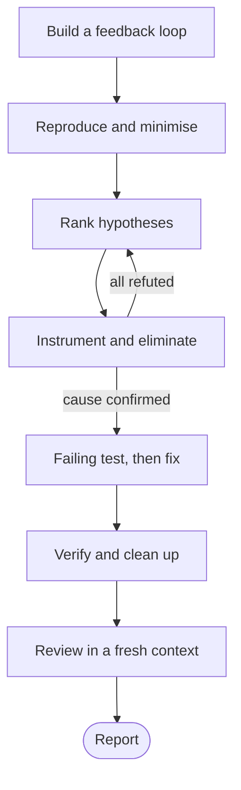

# `/fix-bug`

Fixes a bug with evidence instead of guesses. It builds a check that fails on the bug, finds the cause by ruling out hypotheses, and lands the smallest fix that turns the check green.

```text
/fix-bug <the symptom, an error message, or a log>
```

## When to use it

| Use `/fix-bug` for | Use something else for |
| --- | --- |
| Wrong output, crashes, errors, flaky behavior | New behavior: [`/new-feature`](new-feature.md) |
| Performance regressions ("it got slow after…") | "How does this work?": [`investigate`](../skills.md#investigate) |
| A failing test you don't understand | |

## Usage

```text
/fix-bug the cart total ignores discounts with more than 10 items
/fix-bug TypeError: Cannot read properties of undefined (reading 'id') at InvoiceRow.tsx:42
/fix-bug search got 3x slower since last week's release
```

Paste the stack trace or log after the command if you have one. Redact secrets first. The command replaces any it sees with `<REDACTED>`.

## Steps



### 1. Build a feedback loop

This is the most important step. A **feedback loop** is a fast pass/fail check that goes red on *this* bug. With one, the rest is mechanical. Without one, staring at code rarely helps.

It tries these, roughly in order:

1. A failing test at whatever level reaches the bug
2. A `curl` script against the dev server
3. A CLI run with a fixture input, diffed against a known-good output
4. A headless browser script that checks the DOM, console, or network
5. A replay of a captured request or event log
6. A throwaway harness with the smallest slice of the system
7. A fuzz loop over random inputs, for "sometimes wrong" bugs
8. A `git bisect run` harness, when the bug appeared between two known versions
9. A differential run, old version against new
10. A guided script for you to run, as a last resort when a human must click

Then it makes the loop faster, sharper (it checks the exact symptom, not "didn't crash"), and deterministic (pinned time, seeded randomness).

### 2. Reproduce and minimise

It runs the loop and confirms three things: the failure is the one you described, it shows up across runs, and the exact symptom is captured. Then it cuts inputs, steps, and config one at a time until every remaining piece is needed for the failure.

### 3. Rank hypotheses

It writes 3 to 5 hypotheses, ranked. Each one names a prediction that could prove it wrong:

> If the discount is applied per page of 10 items, then a cart of 11 items with the discount on item 11 will show the wrong total.

It shows you the list before testing. You may know which one to check first, or which you've already ruled out. If you're away, it goes on with its own ranking.

### 4. Instrument and eliminate

It tests one variable at a time. A debugger or REPL comes first. Next come targeted logs at the boundaries between hypotheses, each tagged with a unique prefix such as `[DEBUG-a4f2]`, so cleanup takes a single grep. For performance bugs it measures a baseline first, then bisects.

When the evidence refutes a hypothesis, it reverts any change that hypothesis motivated.

### 5. Failing test, then fix

1. It creates a branch if you're on `main`.
2. It turns the minimal repro into a failing test at the right seam. That means a test that exercises the real bug pattern, not a shallow stand-in.
3. It commits the failing test.
4. It applies the **smallest change the evidence justifies**, and commits the fix.

If there is no good seam for a test, it says so. That gap is part of the result: the code's structure is hiding the bug.

### 6. Verify and clean up

- The original, un-minimised loop now passes.
- The full check set from `verify.md` passes.
- Every `[DEBUG-…]` line and throwaway harness is removed.

### 7. Review

`code-review` reads the diff in a fresh context. The review checks for missed root causes and patches that only hide the symptom.

## What it writes

| Output | Where |
| --- | --- |
| Failing-test commit, then fix commit | A branch |
| Notes for a hunt that spans sessions (only if needed) | `docs/work/<bug-slug>/notes.md` |

## Where it stops

- After ranking hypotheses, briefly, so you can re-rank them.
- If it cannot build any feedback loop. It tells you what it tried and what it needs from you, such as access, data, or a way to trigger the bug.
- Before any push or pull request.

## Skills it calls

| Step | Skill |
| --- | --- |
| 1–4 | [`diagnosing-bugs`](../skills.md#diagnosing-bugs) |
| 5 | [`tdd`](../skills.md#tdd) |
| 7 | [`code-review`](../skills.md#code-review) |

## What you get back

What was broken, the root cause (the hypothesis that held up), the fix, and how it was verified. It also pastes the loop output twice: failing before the fix, passing after.

## Sources

Steps 1–6 adapt Matt Pocock's [`diagnosing-bugs`](https://github.com/mattpocock/skills/tree/main/skills/engineering/diagnosing-bugs). The evidence rules and commit order come from poteto's [bug-fix playbook](https://github.com/cursor/plugins/blob/main/pstack/skills/poteto-mode/playbooks/bug-fix.md).
