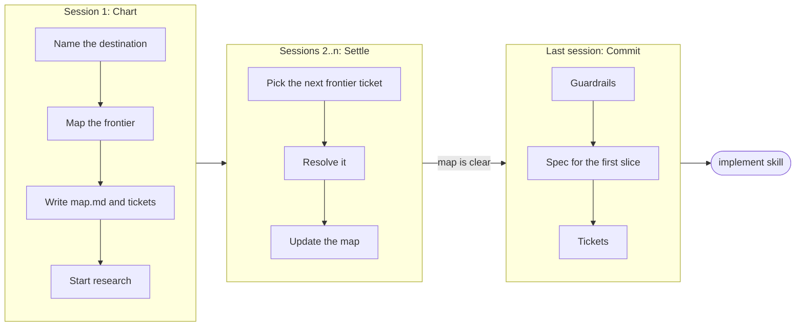

# `/new-app`

Takes a new app from a loose idea to a first spec and tickets. Big ideas start out foggy: you can't see the whole way there yet. So `/new-app` charts a **map** of decisions and settles them one at a time, across several sessions, until the way is clear. It also sets up test, typecheck, lint, and CI from day one.

```text
/new-app <the idea>                # chart the map
/new-app docs/work/<slug>          # settle the next decision on the map
```

## When to use it

| Use `/new-app` for | Use something else for |
| --- | --- |
| A new product or service from scratch | A feature in an existing app: [`/new-feature`](new-feature.md) |
| A rewrite big enough to need its own plan | Building the tickets it writes: the [`implement`](../skills.md#implement) skill |
| Any effort too big for one session to hold | |

## Usage

```text
/new-app a habit tracker that syncs between phone and web, offline first
/new-app docs/work/habit-tracker
```

## The three phases



Each run of `/new-app` does one phase step and then stops. Run `/new-app docs/work/<slug>` to come back.

### Before phase 1: setup

If the repo has no `docs/agents/` yet, it runs [`/setup-airman`](../setup.md) first. In an empty folder, it offers to `git init`.

### Phase 1: Chart the map (one session)

1. **Name the destination.** It grills you until the end point is sharp, for example "a spec for the MVP that a developer can build from". The destination fixes the scope.
2. **Map the frontier.** It grills again, this time breadth-first, across the whole space: platform, data, sync, auth, hosting, and so on. The goal is to surface the open decisions, not to answer them yet.
3. **Write the map.** It creates `docs/work/<slug>/map.md` with these sections:
   - **Destination**: what "done" looks like
   - **Notes**: standing preferences for this effort
   - **Decisions so far**: empty at the start
   - **Not yet specified**: the fog, meaning questions you can sense but can't phrase sharply yet
   - **Out of scope**: what this effort will not do
4. **Write the tickets you can phrase now.** Each one goes in `issues/NN-*.md` with a `Type`:

   | Type | Resolved by | Example |
   | --- | --- | --- |
   | `research` | An agent reading primary sources | "Which sync engines support offline-first on iOS and web?" |
   | `prototype` | A throwaway build you react to | "Does a streak calendar or a list feel better?" |
   | `grilling` | A conversation with you | "Is social sharing in the MVP?" |
   | `task` | Manual work that unblocks a decision | "Create a test account on the sync provider" |

5. **Start research.** It resolves `research` tickets in the background where the tool allows, so the answers are ready next session.

### Phase 2: Settle decisions (one ticket per session)

Each run picks the first frontier ticket, unless you name one, and resolves it by its type:

- `grilling` runs `grilling` with `domain-modeling`, so terms and decisions are written down as they settle.
- `prototype` runs `prototype`. The prototype stays on a throwaway branch, and only the decision moves on.
- `research` runs `research`.

Then it records the answer in the ticket, marks it `done`, and adds a one-line pointer under **Decisions so far**. Any fog the answer cleared up becomes new tickets.

It resolves only **one** ticket per session, apart from research. That keeps each decision focused and each session's context small.

### Phase 3: Commit to a plan (one session)

When the map has no open tickets and nothing left in **Not yet specified**:

1. **Guardrails.** It makes sure the repo has a test command, a typecheck command (where the language has one), a lint command, and one CI job that runs all three. Then it records them in `docs/agents/verify.md`.
2. **Spec.** `to-spec` writes `docs/work/<slug>/spec.md` for the first slice, usually the MVP.
3. **Tickets.** `to-tickets` splits the spec into slices with blocking edges.
4. **Stop.** Next, build the tickets with the [`implement`](../skills.md#implement) skill.

## What it writes

| Path | Phase |
| --- | --- |
| `docs/work/<slug>/map.md` | 1, updated in 2 |
| `docs/work/<slug>/issues/NN-*.md` (decision tickets) | 1, 2 |
| `GLOSSARY.md`, `docs/adr/NNNN-*.md` | 2 |
| Test, typecheck, and lint config, plus a CI workflow | 3 |
| `docs/agents/verify.md` | 3 |
| `docs/work/<slug>/spec.md` and build tickets | 3 |

## Where it stops

At the end of every phase step. A run never settles more than one non-research decision, and it never starts building the app itself.

## Skills it calls

| Step | Skill |
| --- | --- |
| Map and tickets | [`wayfinder`](../skills.md#wayfinder) |
| Grilling tickets | [`grilling`](../skills.md#grilling), [`domain-modeling`](../skills.md#domain-modeling) |
| Prototype tickets | [`prototype`](../skills.md#prototype) |
| Research tickets | [`research`](../skills.md#research) |
| Spec and build tickets | [`to-spec`](../skills.md#to-spec), [`to-tickets`](../skills.md#to-tickets) |

## Sources

The map and phases adapt Matt Pocock's [`wayfinder`](https://github.com/mattpocock/skills/tree/main/skills/engineering/wayfinder). The guardrails step follows his [`retro`](https://github.com/mattpocock/skills/tree/main/skills/engineering/retro) finding that a repo with no lint or CI is a standing gap. The dependency-first planning comes from poteto's [multi-phase plan playbook](https://github.com/cursor/plugins/blob/main/pstack/skills/poteto-mode/playbooks/multi-phase-plan.md).
