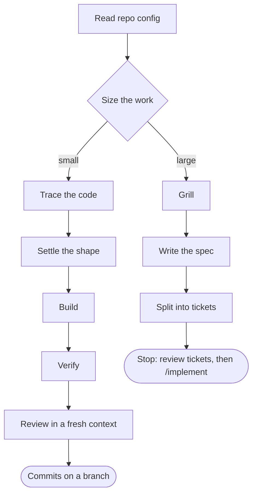

# `/new-feature`

Builds a brand-new feature. It first decides whether the work is **small** or **large**. A small feature gets built and verified right away. A large one gets planned into a spec and tickets, and then the command stops.

```text
/new-feature <what you want, in your own words>
```

## When to use it

| Use `/new-feature` for | Use something else for |
| --- | --- |
| A new capability: "let users export invoices as CSV" | Something broken: [`/fix-bug`](fix-bug.md) |
| A new screen, endpoint, or command | A whole new app: [`/new-app`](new-app.md) |
| A feature you can describe in a few sentences | Tickets that already exist: the [`implement`](../skills.md#implement) skill |

## Usage

```text
/new-feature add a "copy link" button to each shared document
/new-feature let admins invite users by email, with a 7-day expiring link
/new-feature
```

With no description, it asks what you want to build.

## Steps



### 1. Read repo config

It reads `docs/agents/` and `GLOSSARY.md`. If a file it needs is missing, it asks you to run [`/setup-airman`](../setup.md).

### 2. Size the work

The work is **small** when all of these are true:

- It touches one or two files.
- The approach is obvious, with no real design choice to make.
- It adds no new data model or public interface.

Otherwise it is **large**. The command states its verdict and the reason in one line. You can override it ("treat this as small").

### 3. Small path

**a. Trace the code.** It reads the code the change touches and how it is called today.

**b. Settle the shape.** Before writing logic, it decides on the data structures, function signatures, and how a caller will use them. A good shape makes the rest of the code obvious.

**c. Build.** It creates a branch if you're on `main`. Where a cheap test path exists, it writes the test first (`tdd`).

**d. Verify.** It runs the single-file tests while working, then the full set from `verify.md`. If the feature has a visible surface, such as a page, an endpoint, or a CLI, it exercises that too. "Inconclusive" counts as a failure and gets reported.

**e. Review.** `code-review` checks the diff in a fresh context against the repo's standards and your request. It fixes the findings it accepts, then commits in small units.

### 4. Large path

**a. Grill.** `grilling` interviews you in rounds until you share an understanding. Each question comes with a recommended answer. If new terms or hard-to-reverse decisions come up, `domain-modeling` records them in `GLOSSARY.md` and ADRs.

**b. Write the spec.** `to-spec` turns the conversation into `docs/work/<slug>/spec.md`. Before writing, it checks with you where the feature will be tested (the seams).

**c. Split into tickets.** `to-tickets` breaks the spec into thin end-to-end slices in `docs/work/<slug>/issues/`. Each slice declares which tickets block it.

**d. Stop.** You read the tickets. When they look right, build them with the [`implement`](../skills.md#implement) skill: `/implement docs/work/<slug>`.

## What it writes

| Path | Small | Large |
| --- | --- | --- |
| A branch with small commits | ✅ | — |
| `docs/work/<slug>/spec.md` | — | ✅ |
| `docs/work/<slug>/issues/NN-*.md` | — | ✅ |

## Where it stops

- After the size verdict, if you disagree.
- After grilling, until you confirm the shared understanding.
- After the tickets are written. Large features never go straight to code.
- Before any push or pull request.

## Skills it calls

| Step | Skill |
| --- | --- |
| Small: build | [`tdd`](../skills.md#tdd) |
| Small: review | [`code-review`](../skills.md#code-review) |
| Large: grill | [`grilling`](../skills.md#grilling), [`domain-modeling`](../skills.md#domain-modeling) |
| Large: spec | [`to-spec`](../skills.md#to-spec) |
| Large: tickets | [`to-tickets`](../skills.md#to-tickets) |

## What you get back

- **Small:** what was built, the shape it chose and why, how it was verified (with command output), and anything left open.
- **Large:** the spec path, the ticket list with blocking edges, and the command to run next.

## Sources

The small path follows poteto's [feature playbook](https://github.com/cursor/plugins/blob/main/pstack/skills/poteto-mode/playbooks/feature.md). The large path follows Matt Pocock's [`to-spec`](https://github.com/mattpocock/skills/tree/main/skills/engineering/to-spec) and [`to-tickets`](https://github.com/mattpocock/skills/tree/main/skills/engineering/to-tickets) flow.
