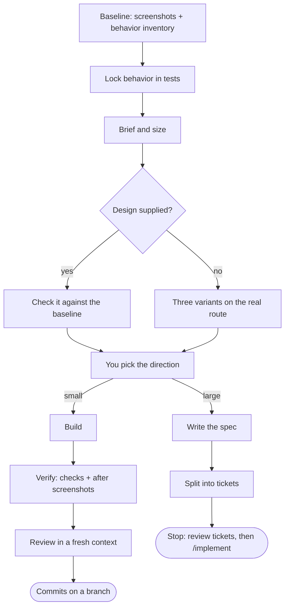

# `/revamp-page`

Redesigns an existing page without losing what it does. It records how the page looks and behaves today, locks that behavior in tests, lets you pick a direction, and then builds a small revamp or plans a large one into tickets.

```text
/revamp-page <the page> <what should get better>
```

## When to use it

| Use `/revamp-page` for | Use something else for |
| --- | --- |
| A page that works but looks dated, cluttered, or hard to scan | A new page or new behavior: [`/new-feature`](new-feature.md) |
| A new layout or hierarchy for an existing screen | Something broken on the page: [`/fix-bug`](fix-bug.md) |
| Building a page to match a Figma design or a mockup | Trying layouts with no plan to ship: [`prototype`](../skills.md#prototype) |

## Usage

```text
/revamp-page /settings the sections are hard to find, and it falls apart on mobile
/revamp-page src/app/invoices/page.tsx make the table easier to scan
/revamp-page /pricing match https://www.figma.com/design/<file>/Pricing
/revamp-page
```

With no page, it asks which one. A Figma link, mockup, or reference screenshot after the goal replaces the variants step.

## Steps



### Screenshots

The command needs to see the page before and after. It always tries to run the app and take the screenshots itself. If your tool can't take screenshots, it tells you why and gives you an exact list: URL, viewport, state, and file name. It waits until you've saved them to `docs/work/<slug>/screens/`. It never skips a screenshot or guesses a layout from the code.

The default viewports are 1440px desktop and 390px mobile.

### 1. Baseline

It reads the page's code, takes before screenshots of every state (normal, loading, empty, error), and writes `docs/work/<slug>/baseline.md`. That file holds a **behavior inventory**: one line per thing the page does, each with an ID.

```text
B1  Lists invoices, newest first, 20 per page
B2  "Delete" opens a confirm dialog, then calls DELETE /invoices/:id
B3  Status filter writes ?status= to the URL
B4  Shows "No invoices yet" when the list is empty
```

Every item starts as `Keep`. The rest of the command checks its work against this list.

### 2. Lock behavior

It creates a `revamp/<slug>` branch if you're on `main`. Then it writes **characterization tests**: tests that record what the page does today, rather than what it should do. They pass on the current code and must still pass after the revamp.

The tests find elements by role, label, and visible text, such as "the button named Delete". They never use class names or DOM structure, because those change in a revamp even when the behavior doesn't.

If a test fails on the current code, it has found a bug. It notes the bug and suggests `/fix-bug`, but doesn't fix it here. An item with no place to test it is marked `manual` and gets checked by hand in step 6.

### 3. Brief and size

`grilling` asks a few short questions: what's wrong with the page today, who uses it, which baseline items you want to change or drop, and whether the scope is visual, layout, or flow. If the revamp needs new data or a new endpoint, that part goes to `/new-feature`.

The work is **small** when it's one page, visual or layout scope, and uses only existing data. Otherwise it's **large**. You can override the verdict.

### 4. Direction

- **You supplied a design.** It reads the design and lists every place the design drops or breaks a `Keep` item. You decide each one.
- **No design.** `ui-ux-pro-max` finds a direction that fits the page and stays inside the repo's design system. Then `prototype` builds three structurally different variants on the real route, switched with `?variant=`, using real data. It screenshots each variant.

It stops until you pick a variant, or parts of several.

It won't change design tokens (colors, fonts, spacing, radius) on its own, because they affect every page. If the repo has no design system, `ui-ux-pro-max` creates one here.

### 5. Small path: build

It folds in the chosen variant, built from the repo's components (`shadcn` if the repo uses it, and `no-use-effect` for React). Data fetching, API calls, routes, and URL parameters stay as they are. The characterization tests stay green the whole time. A test may change only for an item you marked `Change` or `Drop`.

### 6. Small path: verify

- The full check set from `verify.md` passes.
- After screenshots are taken at the same viewports and states as the before set.
- Every baseline item gets `pass`, `fail`, or `unverified` under `## Results`. "Inconclusive" counts as a failure.

### 7. Small path: review

`code-review` reads the diff in a fresh context, with `baseline.md` in hand, and looks for behavior that changed without your say. `ui-ux-pro-max` reviews the result for accessibility, touch targets, interaction states, contrast, and responsive layout.

### Large path: plan, instead of 5–7

`to-spec` writes the spec, with the `Keep` items as acceptance criteria. `to-tickets` splits it into one ticket per section or page, and each ticket lists the baseline items it must keep. Then it stops. Build the tickets with `/implement docs/work/<slug>`.

## What it writes

| Path | Small | Large |
| --- | --- | --- |
| `docs/work/<slug>/baseline.md` | ✅ | ✅ |
| `docs/work/<slug>/screens/` | ✅ | ✅ |
| Characterization tests, committed first | ✅ | ✅ |
| A branch with small commits | ✅ | — |
| `docs/work/<slug>/spec.md` and `issues/` | — | ✅ |

## Where it stops

- When a screenshot can't be taken, until you supply it.
- When the revamp needs new data or an endpoint, or a change to the design tokens.
- When a supplied design conflicts with a `Keep` item.
- After the variants, until you pick one.
- After the tickets are written, on the large path.
- Before any push or pull request.

## Skills it calls

| Step | Skill |
| --- | --- |
| 2 | [`tdd`](../skills.md#tdd) |
| 3 | [`grilling`](../skills.md#grilling) |
| 4 | [`ui-ux-pro-max`](../skills.md#ui-ux-pro-max), [`prototype`](../skills.md#prototype) |
| 5, small | [`shadcn`](../skills.md#shadcn), [`no-use-effect`](../skills.md#no-use-effect) |
| 5, large | [`to-spec`](../skills.md#to-spec), [`to-tickets`](../skills.md#to-tickets) |
| 7 | [`code-review`](../skills.md#code-review), [`ui-ux-pro-max`](../skills.md#ui-ux-pro-max) |

## What you get back

- **Small:** what changed per section, the direction and why, before and after screenshots in pairs, the baseline results (kept, changed, dropped, unverified), the check output, and the commits.
- **Large:** the baseline, the direction, the spec path, the tickets with their blocking edges, and the command to run next.

## Sources

The variants step uses Matt Pocock's [`prototype`](https://github.com/mattpocock/skills/tree/main/skills/engineering/prototype). The build, verify, and review loop follows poteto's [feature playbook](https://github.com/cursor/plugins/blob/main/pstack/skills/poteto-mode/playbooks/feature.md). Characterization tests come from Michael Feathers' *Working Effectively with Legacy Code*.
