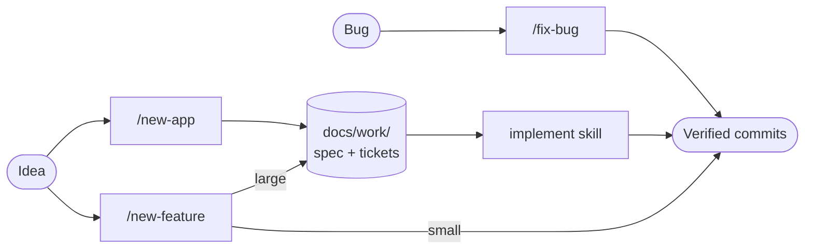

# Concepts

Airman Mode rests on five ideas. Each section covers one.

- [Commands and skills](#commands-and-skills)
- [Repo config](#repo-config)
- [The work folder](#the-work-folder)
- [Proof over claims](#proof-over-claims)
- [Moving between tools and sessions](#moving-between-tools-and-sessions)

## The lifecycle at a glance



## Commands and skills

Airman Mode has two kinds of `SKILL.md`. Both live in this repo and both install the same way. What differs is their job.

| | Command | Skill |
| --- | --- | --- |
| **Job** | Runs a whole workflow by calling skills in a fixed order | Does one thing well |
| **Examples** | `/new-feature`, `/fix-bug`, `/new-app` | `tdd`, `to-spec`, `implement` |
| **Who starts it** | You, by typing its name | You, a command, or the agent |
| **Calls** | Skills only, never another command | Sometimes other skills |
| **Lives in** | `skills/commands/<name>/` | `skills/<name>/` |

### How they look in your tool

Installed skills are flat, so your tool's `/` menu shows commands and skills side by side. Every command's description starts with `Command.`, so you can tell them apart:

```text
/new-feature Command. Run only when the user types /new-feature. Builds a new feature.
/fix-bug     Command. Run only when the user types /fix-bug. Diagnoses and fixes a bug.
/tdd         Test-driven development with a red-green-refactor loop.
/to-spec     Turn the conversation into a spec.
```

The words `Run only when the user types /new-feature` matter too. Some tools ignore the `disable-model-invocation` flag, and without that sentence the agent could start a whole workflow on its own after you ask for something small.

## Repo config

Commands need to know a few things about each repo. `/setup-airman` writes them once, to `docs/agents/`:

| File | Answers | Used by |
| --- | --- | --- |
| `issue-tracker.md` | Where do specs and tickets live, and how do I create and read them? | `/new-feature`, `/new-app`, `implement`, `to-spec`, `to-tickets` |
| `glossary-and-decisions.md` | Where are the glossary and ADRs, and how should I use them? | Every command that explores code |
| `verify.md` | How do I test, typecheck, lint, and run this app? | `/fix-bug`, `/new-feature`, `implement` |

It also adds a three-line block to `AGENTS.md` that points to these files. `AGENTS.md` is loaded in every session, so it stays short: pointers only, no rules. See [Repo setup](setup.md).

## The work folder

Specs, tickets, and maps are plain markdown files, committed to the repo. Every tool can read them, and the history stays with the code.

```text
docs/work/
└── invoice-csv-export/
    ├── spec.md              # what and why, written by to-spec
    ├── map.md               # only for /new-app: destination and decisions so far
    └── issues/
        ├── 01-export-endpoint.md
        ├── 02-csv-serializer.md
        └── 03-download-button.md
```

A ticket is one file with two status lines at the top:

```markdown
# 02 — CSV serializer

Status: open
Blocked by: 01

## What to build
Turn an invoice list into RFC 4180 CSV with a header row.

## Acceptance criteria
- [ ] Amounts use the invoice currency's decimal places
- [ ] Commas and quotes in descriptions are escaped

## Comments
```

`Status` is `open`, `in-progress`, or `done`. `Blocked by` lists the tickets that must be `done` first.

The **frontier** is every open ticket whose blockers are all done. The `implement` skill always works from the frontier. Frontier tickets don't depend on each other, so a tool with subagents can build them in parallel.

> [!NOTE]
> GitHub Issues works too. Pick it in `/setup-airman`, and commands use `gh` instead of files.

## Proof over claims

"It compiles" and "the agent says it works" don't count as done. Airman Mode asks for evidence at three points:

1. **Before a fix.** `/fix-bug` builds a check that fails on the bug before it changes any code. Without a failing check, you can't show the fix fixed anything.
2. **Before a commit.** Commands run the commands in `verify.md`, and check the change on the real surface (the page, the endpoint, the CLI) when there is one.
3. **Before you trust it.** Review runs in a **fresh context**: an agent that did not write the code reads the diff and the spec. A different model is better still. Your tool guide explains how to do that in your tool.

### Git rules

- If you're on `main`, commands create a branch first.
- They commit in small units, each one verified before the next.
- `/fix-bug` commits the failing test before the fix, so the history shows the bug and then its cure.
- They never push or open a pull request unless you ask.

## Moving between tools and sessions

Because all state lives in files and git, switching tools takes two steps:

1. In the session you're leaving, run `/handoff`. It prints a summary in the chat that points to the spec, the tickets, and the commits instead of copying them.
2. Paste it as the first message of a new session, in any tool, in the same repo. The new session reads the work folder and git history, and re-checks anything the handoff marks as unverified.

## Terms

| Term | Meaning |
| --- | --- |
| **Command** | A skill that chains other skills into a workflow. You start it by name. |
| **Skill** | A `SKILL.md` that does one job. |
| **Repo config** | The three files in `docs/agents/` that `/setup-airman` writes. |
| **Work folder** | `docs/work/<slug>/`, which holds the spec, tickets, and map for one piece of work. |
| **Frontier** | Open tickets whose blockers are all done. |
| **Feedback loop** | A fast check that goes red on a bug and green once it's fixed. |
| **Fresh context** | A review by an agent that didn't write the code. |
| **Handoff** | A chat summary you paste into the next session. |
