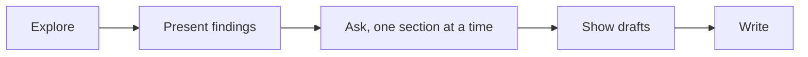

# Repo setup: `/setup-airman`

`/setup-airman` prepares one repo for Airman Mode. It writes three short config files that commands read, and adds a pointer block to `AGENTS.md`. Run it once per repo.

```text
/setup-airman
```

## When to run it

| Situation | What to say |
| --- | --- |
| First time in a repo | `/setup-airman` |
| Switching from local tickets to GitHub Issues | `/setup-airman switch the tracker to GitHub` |
| Checking that the config still matches the repo | `/setup-airman check my setup, don't change anything` |

You can also edit the files in `docs/agents/` by hand at any time.

## Steps



### 1. Explore

Setup reads the repo before it asks anything:

- `git remote -v`: is there a GitHub or GitLab remote?
- `AGENTS.md` and `CLAUDE.md`: do they exist, and is there already an `## Agent skills` block?
- `GLOSSARY.md`, `GLOSSARY-MAP.md`, `docs/adr/`: is there a domain model already?
- `docs/agents/` and `docs/work/`: has setup run before?
- `package.json` scripts, `Makefile`, `justfile`, `pyproject.toml`, CI workflows: how are tests, typecheck, and lint run today?
- Workspace files such as `pnpm-workspace.yaml` or `packages/*`: is this a monorepo?

### 2. Present findings

It sums up what exists and what is missing, in a few lines.

### 3. Ask, one section at a time

Each question leads with the recommended answer, so you can accept it in one word. If exploration already settled a section, setup skips it.

**A. Issue tracker.** Where do specs and tickets live?

| Option | When to pick it |
| --- | --- |
| **Local markdown** (default) | Solo work, or any time you switch tools. Files live in `docs/work/`. |
| GitHub Issues | The repo has a GitHub remote and you already track work there. Needs `gh`. |
| GitLab Issues | The repo has a GitLab remote. Needs `glab`. |
| Other | Jira, Linear, and so on. You describe the workflow in a paragraph. |

**B. Glossary and decisions.** Single context (default) means one `GLOSSARY.md` at the root and ADRs in `docs/adr/`. Multi-context is offered only in a monorepo. It adds a `GLOSSARY-MAP.md` that points to one glossary per package.

**C. Verify commands.** Setup proposes the commands it found for each check, and you confirm or correct them. If the repo has no test, typecheck, or lint command, or no CI job, setup says so. That gap is worth fixing.

### 4. Show drafts

You see all three files and the `AGENTS.md` block before anything is written, and you can edit them.

### 5. Write

- It writes `docs/agents/issue-tracker.md`, `docs/agents/glossary-and-decisions.md`, and `docs/agents/verify.md`.
- It adds or updates the `## Agent skills` block in `AGENTS.md`. If the block already exists, setup updates it in place and leaves the rest of the file alone.
- If the repo also has a `CLAUDE.md`, setup asks whether to add the same block there.

## What it writes

### `AGENTS.md` block

```markdown
## Agent skills

- **Tickets:** local markdown in `docs/work/`. See `docs/agents/issue-tracker.md`.
- **Glossary and decisions:** single context. See `docs/agents/glossary-and-decisions.md`.
- **Verify:** test, typecheck, lint, and run commands. See `docs/agents/verify.md`.
```

### `docs/agents/issue-tracker.md` (local markdown)

```markdown
# Issue tracker: local markdown

Specs and tickets live as markdown files in `docs/work/`, committed to the repo.

## Layout
- One folder per piece of work: `docs/work/<slug>/`
- The spec is `docs/work/<slug>/spec.md`
- Tickets are one file each: `docs/work/<slug>/issues/<NN>-<slug>.md`, numbered from 01
- A wayfinding map, when there is one, is `docs/work/<slug>/map.md`

## Ticket header
- `Status: open | in-progress | done`
- `Blocked by: 01, 02` (omit when nothing blocks it)
- Map tickets also carry `Type: research | prototype | grilling | task`

## Operations
- **Publish:** create the file, and the folder if needed.
- **Fetch:** read the file at the given path or number.
- **Claim:** set `Status: in-progress` and save before starting work.
- **Close:** set `Status: done`, and add a one-line note under `## Comments`.
- **Frontier:** open tickets whose `Blocked by` tickets are all `done`, lowest number first.
```

### `docs/agents/glossary-and-decisions.md`

```markdown
# Glossary and decisions

## Before exploring, read
- `GLOSSARY.md` at the repo root, for the project's terms.
- `docs/adr/`, for ADRs that touch the area you are working in.

If they don't exist, carry on without them, and don't suggest creating them up front.
The domain-modeling skill creates them when a term or decision is settled.

## Rules
- Use glossary terms in names, tickets, tests, and replies. Don't drift to synonyms.
- If your work contradicts an ADR, say so explicitly instead of silently overriding it.
```

### `docs/agents/verify.md`

```markdown
# Verify

| Check | Command |
| --- | --- |
| Install | `pnpm install` |
| Test (all) | `pnpm test` |
| Test (one file) | `pnpm test -- <path>` |
| Typecheck | `pnpm typecheck` |
| Lint | `pnpm lint` |
| Run the app | `pnpm dev` (http://localhost:3000) |
| CI | `.github/workflows/ci.yml` runs test, typecheck, and lint |

Run the single-file test often while working, and the full set before each commit.
```

These are examples. Setup fills in what it finds in your repo.

## Which commands need which file

A command that **needs** a file stops and asks you to run `/setup-airman` if the file is missing. A command that **uses** a file works without it, with less precise results.

| | `issue-tracker.md` | `glossary-and-decisions.md` | `verify.md` |
| --- | --- | --- | --- |
| `/new-feature` | Needs (large path) | Uses | Needs (small path) |
| `/fix-bug` | — | Uses | Needs |
| `/new-app` | Needs | Uses | Creates or updates |
| `/revamp-page` | Needs (large path) | Uses | Needs |
| `implement` skill | Needs | Uses | Needs |

## Source

Adapted from [`setup-matt-pocock-skills`](https://github.com/mattpocock/skills/tree/main/skills/engineering/setup-matt-pocock-skills). The changes: there are no triage labels, `verify.md` is new, the tracker defaults to local markdown, and the work folder is `docs/work/`.
